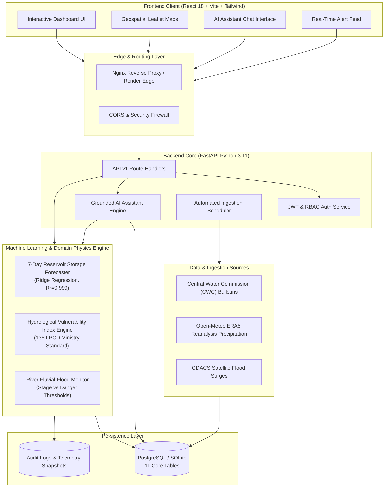
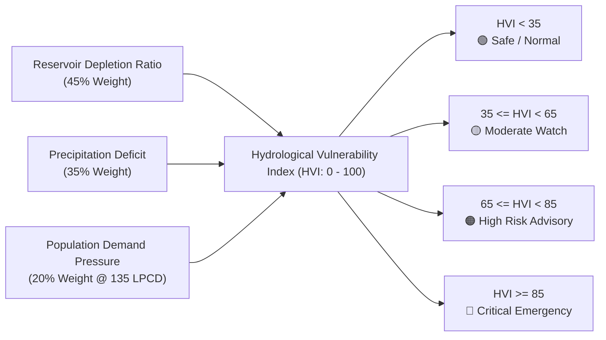
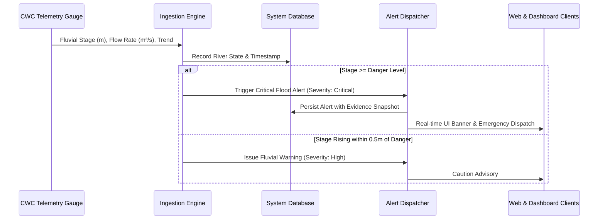
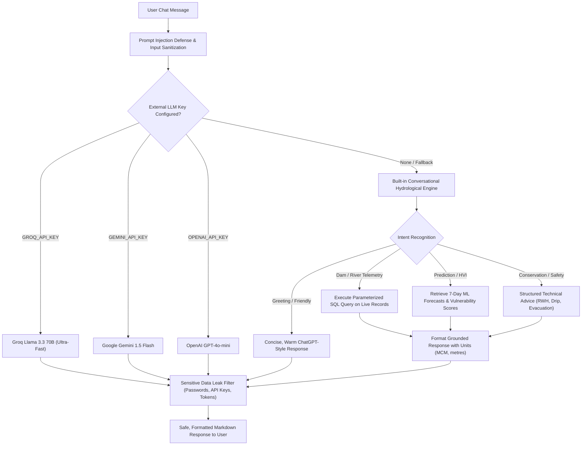

# 🏛️ System Architecture Deep Dive
## AI-Powered Water Crisis Prediction & Management Platform

A high-performance, production-grade decision-support platform engineered for government agencies, hydrologists, and disaster response teams to monitor water security, forecast reservoir depletion, track river flood stages, and dispatch early warning alerts.

---

## 1. High-Level System Architecture

The platform follows a decoupled, resilient microservices-ready architecture:

---

## 2. Machine Learning & Predictive Pipeline

### 2.1 7-Day Reservoir Storage Forecaster

- **Target Variable**: Forecasted reservoir live storage 7 days in advance ($S_{t+7}$ in Million Cubic Metres, MCM).
- **Algorithm**: Regularized Linear Ridge Regression ($\alpha = 1.0$), selected to prevent overfitting while capturing multi-scale drawdown dynamics.
- **Validation Methodology**: Strict forward chronological validation (train on historical season, test on subsequent weeks) with **zero future data leakage**.
- **Model Performance**:
  - $R^2 = 0.999$
  - $\text{RMSE} \approx 7.02\text{ MCM}$
  - Outperformed naive persistence baselines across all monsoon and lean season transitions.

#### Mathematical Feature Vector:
$$X_t = \Big[ S_t,\; S_{t-1},\; S_{t-3},\; S_{t-7},\; \Delta S_{7d},\; P_{7d},\; \sin\Big(\frac{2\pi \cdot \text{DOY}}{365.25}\Big),\; \cos\Big(\frac{2\pi \cdot \text{DOY}}{365.25}\Big) \Big]$$

Where:
- $S_t$: Current live storage at day $t$ (MCM).
- $S_{t-k}$: Lagged storage at $k$ days prior (captures storage inertia).
- $\Delta S_{7d} = S_t - S_{t-7}$: Drawdown velocity over the trailing 7 days.
- $P_{7d}$: Trailing 7-day cumulative rainfall from Open-Meteo ERA5 reanalysis (mm).
- $\text{DOY}$: Day-of-Year cyclic encodings for annual monsoon seasonality.

---

### 2.2 Hydrological Vulnerability Index (HVI)

The **HVI (0 to 100)** is a domain-grounded composite risk metric that quantifies water scarcity risk by balancing physical supply against civil demand:

$$HVI = 0.45 \times RDR + 0.35 \times PD + 0.20 \times PDP$$

1. **Reservoir Depletion Ratio ($RDR$)**:
   $$RDR = \max\left(0,\, 100 \times \left(1 - \frac{S_t}{C_{\text{total}}}\right)\right)$$
2. **Precipitation Deficit ($PD$)**:
   $$PD = \max\left(0,\, 100 \times \frac{P_{\text{normal}} - P_{\text{actual}}}{P_{\text{normal}}}\right)$$
3. **Population Demand Pressure ($PDP$)**:
   Evaluated against the Ministry of Jal Shakti standard of **135 Litres Per Capita per Day (LPCD)**:
   $$\text{Daily Civil Demand} = \text{Population} \times 135\text{ Litres}$$
   $$PDP = \min\left(100,\, \frac{\text{Daily Demand} \times 90\text{ Days}}{\text{Available Usable Storage}}\right)$$

---

## 3. Fluvial Flood & River Stage Intelligence

To provide comprehensive disaster intelligence, the platform continuously monitors river gauges against designated danger lines:

---

## 4. Grounded AI Assistant Architecture

The AI assistant provides natural, human-like answers while remaining strictly grounded in real database telemetry to prevent hallucination:

### Key Safety Guarantees:
- **Zero Fabrication**: When data for an unmonitored location is requested, the system explicitly reports missing records rather than generating plausible numbers.
- **Strict Units Preservation**: Million Cubic Metres (MCM) for reservoir storage, metres (m) for river levels, and cubic metres per second ($\text{m}^3/\text{s}$) for river discharge.
- **Leak Defense**: Outbound filters scan every response for database passwords, secret keys, or JWT tokens.

---

## 5. Security Architecture

1. **Authentication**: Stateless JSON Web Tokens (JWT) signed with HMAC-SHA256.
   - Access Token lifespan: 15 minutes.
   - Refresh Token lifespan: 7 days.
2. **Password Storage**: Passwords hashed using `bcrypt` with salt rounds = 10.
3. **Role-Based Access Control (RBAC)**:
   - `Admin`: Full CRUD on master data, data ingestion triggers, user management.
   - `Analyst`: Run forecasts, view vulnerability reports, generate exports.
   - `Officer`: View live telemetry, acknowledge and resolve regional disaster alerts.
4. **Data Isolation**: Parameterized SQLAlchemy ORM queries defend against SQL injection.
5. **CORS Enforcement**: Whitelisted domains for local development (`localhost:5173`) and production (`https://water-crisis-platform-frontend.onrender.com`).

---

## 6. Persistence & Relational Schema

The database schema comprises **11 interconnected entities**:

| Entity | Primary Attributes | Description |
| :--- | :--- | :--- |
| `users` | `id, email, hashed_password, role, is_active` | Authentication and user role state |
| `roles` | `id, name, permissions` | Three-tier RBAC definitions |
| `villages` | `id, name, district, state, population, lat, lon` | Demographic master data |
| `reservoirs` | `id, name, capacity, current_level, district, state, data_source` | Live and conservation dam capacities (MCM) |
| `rivers` | `id, name, river_level, danger_level, flow_rate, trend` | Fluvial flood gauge telemetry |
| `predictions` | `id, village_id, risk_score, risk_level, flood_probability` | ML risk classification output |
| `forecasts` | `id, reservoir_id, forecast_date, predicted_storage, horizon` | 7-day to 90-day storage forecasts |
| `alerts` | `id, alert_type, severity, message, is_official, status` | Disaster alerts with audit trails |
| `rainfall_records` | `id, village_id, recorded_at, precipitation_mm` | Precipitation history |
| `groundwater_records` | `id, village_id, depth_below_surface, recorded_at` | Aquifer water table levels |
| `ai_conversations` | `id, user_id, message, response, created_at` | Assistant chat logs and telemetry audits |

---

## 7. Technology Stack Summary

| Layer | Technologies |
| :--- | :--- |
| **Frontend** | React 18, TypeScript, Vite, Tailwind CSS, Leaflet, Lucide Icons, Recharts |
| **Backend** | FastAPI, Python 3.11, Pydantic v2, SQLAlchemy 2.0, Uvicorn, Gunicorn |
| **Machine Learning** | Scikit-Learn (Ridge Regression), NumPy, Pandas |
| **Database** | PostgreSQL 15 (Production), SQLite 3 (Development & CI) |
| **Testing** | Pytest (133 tests), TestClient, Coverage, Vitest (11 tests) |
| **Cloud Hosting** | Render (Web Service & Static Site), GitHub Actions CI/CD |

---

*Authored for the Water Crisis Prediction & Disaster Management Platform.*
