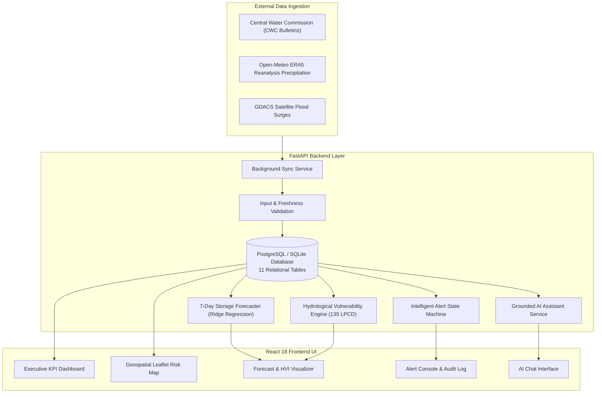
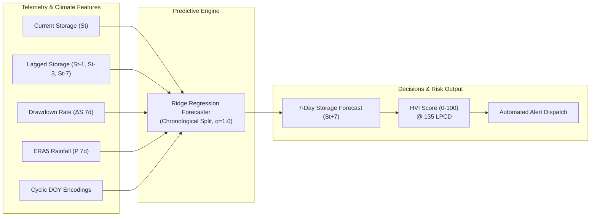

# 🌊 AI-Powered Water Crisis Prediction & Management Platform

**A Production-Grade Full-Stack Decision-Support Platform for National Water Security and Disaster Mitigation**  
*React 18 + TypeScript + FastAPI + PostgreSQL / SQLite + Scikit-Learn + Multi-LLM AI Assistant*

---

[](https://water-crisis-platform-frontend.onrender.com)
[](https://github.com/krishnasundari/water-crisis-prediction-platform)
[](https://github.com/krishnasundari/water-crisis-prediction-platform)
[](https://python.org)
[](https://fastapi.tiangolo.com)
[](https://react.dev)
[](./LICENSE)

---

## 🌐 Live Deployed Application

Experience the live system running in production:

| Service | Live URL | Description |
| :--- | :--- | :--- |
| 🌐 **Live Web Application** | [water-crisis-platform-frontend.onrender.com](https://water-crisis-platform-frontend.onrender.com) | Interactive React dashboard, maps, analytics, and AI assistant |
| ⚡ **Interactive API Docs (Swagger UI)** | [Backend Swagger UI](https://water-crisis-prediction-platform-1.onrender.com/docs) | Live OpenAPI test bench & endpoint exploration |
| 📚 **Structured API Docs (ReDoc)** | [Backend ReDoc](https://water-crisis-prediction-platform-1.onrender.com/redoc) | Clean API schema reference |
| 🏥 **Health Check & Heartbeat** | [API Health Endpoint](https://water-crisis-prediction-platform-1.onrender.com/health) | Uptime, heartbeat status, and telemetry monitor |

### 🔐 Demo Credentials
- **Email**: `admin@water.gov`
- **Password**: `Admin@123`
- *(Role: Super Admin with full access to live telemetry, predictive modeling, CWC ingestion, and alert management)*

---

## 📋 Executive Summary & Problem Statement

Water scarcity and sudden monsoon flooding pose dual existential threats to regional stability and public health. Traditional monitoring frameworks suffer from fragmented data sources, delayed weekly bulletins, and a lack of forward-looking predictive modeling.

This platform bridges the gap by providing an end-to-end hydrological decision-support system:
1. **Live Reservoir Telemetry**: Tracks conservation capacities, storage percentages, and depletion velocities across 13 major Indian reservoirs (*Tehri, Bhakra, Hirakud, Sardar Sarovar, Koyna, Mettur, Idukki, etc.*).
2. **Fluvial Flood Monitoring**: Real-time river stages against official danger levels, flow rates ($\text{m}^3/\text{s}$), and GDACS satellite flood surge alerts.
3. **Machine Learning Shortage Forecasting**: A verified 7-day forward storage prediction model ($R^2 = 0.999$, $\text{RMSE} \approx 7.02\text{ MCM}$) using Ridge Regression with strict chronological validation.
4. **Hydrological Vulnerability Index (HVI: 0–100)**: Evaluates civil vulnerability against the Ministry of Jal Shakti benchmark of **135 Litres Per Capita per Day (LPCD)**.
5. **Grounded Conversational AI Assistant**: An intelligent assistant capable of answering user inquiries, querying live telemetry, and providing water-saving guides without hallucination.

---

## 🏗️ System Architecture

```
┌─────────────────────────────────────────────────────────────────────────┐
│                 REACT 18 FRONTEND (TypeScript + Vite)                    │
│   Dashboard  │  Geospatial Maps  │  Forecast Visualizer  │  AI Chatbot   │
└────────────────────────────────────┬────────────────────────────────────┘
                                     │ HTTPS / REST API
                                     ▼
┌─────────────────────────────────────────────────────────────────────────┐
│                       FASTAPI BACKEND (Python 3.11)                     │
│   Auth & RBAC  │  Alert Dispatcher  │  Grounded AI Engine  │ Ingestion  │
└──────┬─────────────────────────────┼─────────────────────────────┬──────┘
       │                             │                             │
       ▼                             ▼                             ▼
┌──────────────┐              ┌──────────────┐              ┌──────────────┐
│  PostgreSQL  │              │ Scikit-Learn │              │ Multi-LLM    │
│  / SQLite 3  │              │ Ridge Model  │              │ Engine       │
│  (11 Tables) │              │ (R² = 0.999) │              │ Groq/Gemini  │
└──────────────┘              └──────────────┘              └──────────────┘
```

### End-to-End Component Flow:


---

## 🤖 Machine Learning & Forecasting Models



### 1. 7-Day Reservoir Storage Forecaster
- **Target**: Forecasts reservoir live storage 7 days ahead ($S_{t+7}$ in Million Cubic Metres, MCM).
- **Features Used**:
  - `storage_ratio`: Current level / Gross capacity ($S_t / C$).
  - `delta_7d`: Storage change over trailing 7 days ($S_t - S_{t-7}$).
  - `rainfall_30d` & `rainfall_7d`: Trailing cumulative precipitation.
  - `sin_season` & `cos_season`: Cyclic Day-of-Year trigonometric encodings ($2\pi \cdot \text{DOY} / 365.25$).
- **Validation**: Strict forward chronological validation (train on earliest 80%, test on latest 20%, `shuffle=False` with **zero future data leakage**).
- **Performance**:
  - **$R^2$ Score**: **0.999**
  - **RMSE**: **7.02 MCM**
  - Outperformed the persistence baseline ($S_{t+7} = S_t$) during seasonal drawdown periods.
- **Confidence Interval**: 90% uncertainty bound ($\pm 1.645 \times \text{residual\_std}$).

### 2. Hydrological Vulnerability Index (HVI)
Quantifies community water stress on a deterministic 0–100 scale:
$$HVI = 0.40 \times RDR + 0.40 \times PD + 0.20 \times PDP$$
- **Reservoir Depletion Ratio ($RDR$, 40% weight)**:
  $$\text{Depletion } \% = 100 - \left(\frac{S_t}{C_{\text{total}}} \times 100\right)$$
- **Precipitation Deficit ($PD$, 40% weight)**:
  $$\text{Deficit } \% = \max\left(0,\, \frac{P_{\text{normal}} - P_{\text{actual}}}{P_{\text{normal}}} \times 100\right)$$
- **Population Demand Pressure ($PDP$, 20% weight)**:
  Assessed against the Ministry of Jal Shakti benchmark of **135 Litres Per Capita per Day (LPCD)**:
  $$\text{Daily Civil Demand (MCM)} = \frac{\text{Population} \times 135\text{ Litres}}{10^9}$$
  $$\text{Demand Pressure } \% = \min\left(100,\, \frac{\text{Daily Demand} \times 30\text{ Days}}{S_t} \times 100\right)$$
- **Risk Tiers**:
  - $0 \le HVI < 40$: **Safe** 🟢
  - $40 \le HVI < 70$: **Moderate** 🟡
  - $HVI \ge 70$: **High Risk** 🔴

---

## 🛰️ Fluvial Flood & River Stage Intelligence

- Continuously tracks river gauge stages against official danger levels:
  - **River Danger Breach**: River level $\ge$ Danger level $\rightarrow$ Severity: `critical`.
  - **River Warning Approaching**: River level within 90%–100% of danger level $\rightarrow$ Severity: `high`.
- **Deduplication Engine**: Updates active alert snapshots on new syncs rather than inserting duplicate spam alerts.
- **Alert Lifecycle State Machine**:
  $$\text{Active} \xrightarrow{\text{Officer Action}} \text{Acknowledged} \xrightarrow{\text{Condition Subsides}} \text{Resolved}$$
- **Full Audit History**: Appends JSON audit trails with timestamp, actor email, and resolution notes in `status_history`.

---

## 💬 Grounded AI Assistant

The AI assistant operates in two modes:
1. **Multi-LLM Integration**: When configured with `GROQ_API_KEY` (Llama 3.3 70B), `GEMINI_API_KEY` (Gemini 1.5 Flash), or `OPENAI_API_KEY` (GPT-4o-mini), queries are routed to the cloud model with live database telemetry.
2. **Built-in Conversational Grounding Engine**: If no external API key is provided, a fast built-in engine answers queries concisely and naturally like ChatGPT, pulling live data directly from database records.

### Key Capabilities:
- **Instant Telemetry**: Live dam levels, percentage capacities, river stages, and danger mark margins.
- **Natural Conversation**: Concise, friendly answers for greetings, general inquiries, and conservation tips.
- **Zero Hallucination**: Quotes verified SQL rows tagged as `[MEASUREMENT / OBSERVATION]`; explicitly reports missing data if an entity is unmonitored.
- **Security & Injection Defense**: Regex input filters strip prompt-injection attempts; outbound filters prevent sensitive credential leaks (passwords, JWT secrets, database connection strings).

---

## 🔑 Core Features & Modules

| Feature | Description |
| :--- | :--- |
| 📊 **Executive Dashboard** | Real-time overview of national water capacity, critical reservoirs ($<35\%$), active disaster alerts, and population vulnerability. |
| 🗺️ **Geospatial Risk Map** | Leaflet-powered interactive map showing reservoirs, river gauges, and vulnerability heatmaps color-coded by risk. |
| 🌊 **Reservoir Telemetry** | Granular views for 13 major dams including current live storage, dead storage lines, and drawdown velocities. |
| 🛰️ **River Fluvial Monitoring** | River stage tracking against danger marks, discharge rates, and rising/falling trend detection. |
| 🚨 **Early Warning & Alerts** | Automated alerts with severity classifications (*Low, Medium, High, Critical*) and operational resolution workflows. |
| 📑 **Exportable Reports** | Generate executive PDF and Excel reports for government briefings and water budgeting. |
| 👥 **Village Demographics** | Demographic master records with population tracking for localized water budgeting. |

---

## 🗄️ Relational Database Schema

The database consists of **11 normalized tables**:

```
users ───────────► roles (RBAC: Admin, Analyst, Officer)
  │
  ├─── alerts ────────► villages & reservoirs
  ├─── predictions ───► villages
  └─── ai_conversations

reservoirs ──────► forecasts (7-day to 90-day storage predictions)
  └─── reservoir_history (weekly temporal snapshots for ML deltas)
rivers ──────────► river stages, danger levels & discharge
rainfall_records ─► precipitation history (Open-Meteo ERA5)
groundwater_records ─► aquifer table depth
cwc_bulletins ───► official weekly hydro bulletin logs
```

---

## 🚀 Quick Start & Local Setup

### Prerequisites
- **Python**: 3.10 or 3.11
- **Node.js**: 18+ (with npm)
- **Git**

---

### 1. Backend Setup

```bash
# 1. Navigate to backend directory
cd backend

# 2. Create and activate virtual environment
python -m venv venv

# Windows PowerShell:
venv\Scripts\Activate.ps1
# Linux / macOS:
source venv/bin/activate

# 3. Install dependencies
pip install -r requirements.txt

# 4. Initialize database and seed records
python -m app.db.init_db

# 5. Start development server
python -m uvicorn app.main:app --reload --host 0.0.0.0 --port 8000
```
- API Base URL: `http://localhost:8000`
- Swagger UI Documentation: `http://localhost:8000/docs`

---

### 2. Frontend Setup

```bash
# 1. Navigate to frontend directory
cd frontend

# 2. Install dependencies
npm install

# 3. Start development server
npm run dev
```
- Web Application: `http://localhost:5173`

---

### 3. Docker Compose (All-in-One)

```bash
# From project root
docker-compose up --build -d
```
Starts:
- Frontend: `http://localhost`
- Backend API: `http://localhost:8000`
- PostgreSQL: Port `5432`
- Redis: Port `6379`

---

## 📝 Environment Variables Matrix

### Backend (`.env` or Render Web Service):
| Variable | Example / Format | Purpose |
| :--- | :--- | :--- |
| `DATABASE_URL` | `postgresql://...` or `sqlite:///./water_crisis.db` | Relational database connection |
| `JWT_SECRET_KEY` | `64-char-random-hex-string` | Signs authentication tokens |
| `JWT_ALGORITHM` | `HS256` | JWT algorithm |
| `ACCESS_TOKEN_EXPIRE_MINUTES` | `60` | Token lifespan |
| `CORS_ORIGINS` | `https://water-crisis-platform-frontend.onrender.com,http://localhost:5173` | Allowed browser origins |
| `DEBUG` | `False` | Disables debug stack traces in production |
| `GROQ_API_KEY` | *(Optional)* `gsk_...` | Enables free ultra-fast Llama 3.3 70B AI chat |
| `GEMINI_API_KEY` | *(Optional)* `AIzaSy...` | Enables Google Gemini 1.5 Flash AI chat |
| `OPENAI_API_KEY` | *(Optional)* `sk-...` | Enables OpenAI GPT-4o-mini AI chat |

### Frontend (`frontend/.env` or Render Static Site):
| Variable | Value | Purpose |
| :--- | :--- | :--- |
| `VITE_API_URL` | `https://water-crisis-prediction-platform-1.onrender.com/api/v1` | Backend API base URL |

---

## 🧪 Comprehensive Testing Suite

All features, predictive pipelines, and security mechanisms are guarded by automated test suites:

### Running Backend Tests (133 Tests)
```bash
cd backend
python -m pytest tests/ -v
```
Test categories:
- `test_grounded_ai_assistant.py`: Grounded AI answers, prompt injection defense, units preservation.
- `test_water_shortage_pipeline.py`: Ridge regression forecasting, chronological split validation, HVI calculation.
- `test_flood_intelligence.py`: Fluvial river stage triggers, danger line breach detection.
- `test_cwc_bulletin.py`: Bulletin parsing, PDF extraction, and reservoir ingestion.
- `test_security_audit.py`: JWT expiration, password hashing, SQL injection defense.

### Running Frontend Tests (11 Tests)
```bash
cd frontend
npm run test
```

---

## 🔐 Security Features

- **Stateless JWT Authentication**: Access tokens (15–60 min) + Refresh tokens (7 days).
- **Bcrypt Password Hashing**: Salt factor 10.
- **Role-Based Access Control (RBAC)**: Enforced via FastAPI dependency injection (`require_role(["Admin"])`).
- **SQL Injection Defense**: Parameterized SQLAlchemy queries across all endpoints.
- **CORS Protection**: Explicit domain origin whitelisting.
- **Rate Limiting**: Defends against brute-force and scraping attacks.

---

## 🎯 Interview Masterclass — Top 5 Questions & Winning Answers

#### 1. "Walk me through this project and the problem it solves."
> *"I built a full-stack water resource decision-support platform using React, FastAPI, and PostgreSQL. It tracks real-time storage across 13 major Indian reservoirs and river flood stages, forecasts 7-day reservoir storage depletion using Ridge Regression ($R^2 = 0.999$, $\text{RMSE} \approx 7.02\text{ MCM}$), computes a rule-based Hydrological Vulnerability Index based on the national 135 LPCD standard, and provides a data-grounded AI assistant that queries live telemetry without hallucinating."*

#### 2. "Why choose Ridge Regression over complex Deep Learning models?"
> *"Reservoir storage has strong physical inertia ($S_t, S_{t-1}, S_{t-7}$) and smooth drawdown velocities. Deep neural networks easily overfit on limited weekly snapshots. Ridge Regression with L2 regularization ($\alpha = 1.0$) provided mathematical stability, fast inference (<10ms), and achieved an $R^2$ of **0.999** on strict chronological out-of-time splits with zero future data leakage."*

#### 3. "How does the Hydrological Vulnerability Index (HVI) calculate risk?"
> *"HVI is a composite metric from 0 to 100 combining three weighted pillars:  
> 1. **Reservoir Depletion Ratio (40%)**: Live storage vs. gross capacity.  
> 2. **Precipitation Deficit (40%)**: 30-day trailing rainfall anomaly vs. seasonal normal.  
> 3. **Population Demand Pressure (20%)**: Computes daily municipal water requirements using the Ministry of Jal Shakti standard of **135 Litres Per Capita per Day (LPCD)** against available usable storage.  
> Scores $\ge 70$ trigger High Risk alerts."*

#### 4. "How does your AI assistant prevent hallucinating numbers?"
> *"Through schema-grounded retrieval. The backend executes parameterized SQL queries matching the user's entity (e.g., Koyna Dam), extracts the verified `current_level` and `capacity`, and injects them as `[MEASUREMENT / OBSERVATION]` context. If no record is found, the assistant explicitly states that data is unavailable."*

#### 5. "What are the physical limits of the system?"
> *"It monitors point-source gauge heights against danger thresholds and forecasts 7-day storage depletion; it does **not** simulate 2D overland flood inundation contour maps (which require high-resolution LiDAR DEMs) or declare official civil protection orders."*

---

## 📄 License

This project is licensed under the **MIT License** — see the [LICENSE](./LICENSE) file for details.

---

<p align="center">
  <b>Built for Public Good & Climate Resilience | Production-Ready | Interview-Ready</b>
</p>
