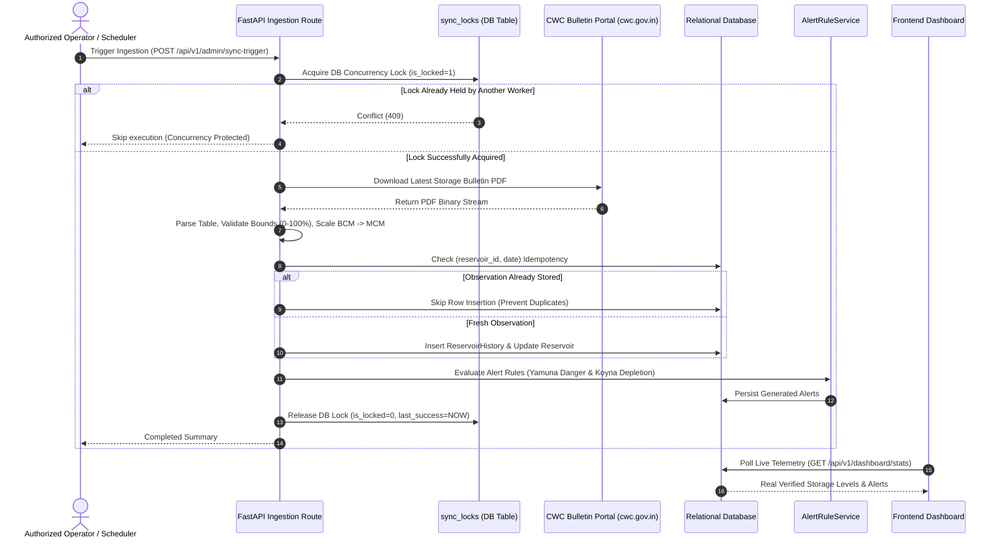

# System Architecture

## 1. Executive Architecture Summary

The **AI-Powered Water Crisis & Disaster Intelligence Platform** is a dual-tier full-stack application designed to aggregate, harmonize, and analyze hydrological telemetry across Indian river basins, reservoirs, and vulnerable rural settlements. It integrates verified government bulletins (Central Water Commission), global disaster alert frameworks (GDACS), meteorological reanalysis (Open-Meteo ERA5-Land), and rule-based vulnerability engines to provide data-grounded situation awareness.

```mermaid
graph TD
    subgraph External Sources
        CWC["Central Water Commission (CWC)<br/>Weekly Storage Bulletins (PDF)"]
        GDACS["GDACS Disaster Framework<br/>Live Flood & Cyclone Feeds (REST)"]
        METEO["Open-Meteo ERA5-Land<br/>Historical & 7-Day Rainfall (REST)"]
    end

    subgraph Backend Layer [FastAPI / Python 3.11]
        INGEST["Ingestion & Sync Engine<br/>(Background Task Loop & Admin Routes)"]
        LOCK["Sync Concurrency Coordinator<br/>(sync_locks DB Locking)"]
        ALERT_ENG["Alert Rule Engine<br/>(Fluvial & Reservoir Thresholds)"]
        HVI_ENG["Hydrological Vulnerability Engine<br/>(HVI Scoring & Ridge Forecaster)"]
        AI_SRV["Data-Grounded AI Engine<br/>(GroundedAIService & Secret Redaction)"]
        RATE_LIM["In-Memory Rate Limiter<br/>(Sliding Window Token Bucket)"]
        AUTH_SRV["Auth & RBAC Service<br/>(JWT HS256, HTTPBearer, Google OAuth)"]
    end

    subgraph Persistence Layer [SQLAlchemy 2.0 ORM]
        DB[(Persistent Relational Storage<br/>PostgreSQL / SQLite Dialect)]
    end

    subgraph Frontend Client [React 18 / TypeScript / Vite]
        DASH["Dashboard & Overview<br/>(Hydrological KPIs & Charts)"]
        MAP_VIEW["Interactive Leaflet Map<br/>(Boundaries, Dams, Rivers)"]
        ALERT_VIEW["Alerts & Warnings<br/>(Official Bulletins vs Modeled)"]
        AI_CHAT["Grounded AI Assistant<br/>(Factual Citation & Evidence)"]
        REPORTS["Audit-Proof Reports<br/>(PDF & Structured CSV Export)"]
    end

    CWC --> INGEST
    GDACS --> INGEST
    METEO --> INGEST

    INGEST <--> LOCK
    INGEST --> DB
    DB --> ALERT_ENG
    DB --> HVI_ENG
    DB --> AI_SRV

    AUTH_SRV <--> DB
    RATE_LIM --> AUTH_SRV

    DASH <--> Backend Layer
    MAP_VIEW <--> Backend Layer
    ALERT_VIEW <--> Backend Layer
    AI_CHAT <--> Backend Layer
    REPORTS <--> Backend Layer
```

---

## 2. Component Architecture

### 2.1 Backend Layer (FastAPI)
- **Framework**: FastAPI 0.104.1 running on Uvicorn / Gunicorn under Python 3.11.
- **Routing Structure**: Modular API routes under `/api/v1/`:
  - `/auth`: Registration, JWT access/refresh token issuance, rate-limited login, password reset flow, Google OAuth token verification.
  - `/reservoirs`: Live storage telemetry, reservoir history, physical capacities.
  - `/rivers`: Fluvial river stage stations, danger levels, flow rates.
  - `/villages`: Settlement populations, water sources, coordinates.
  - `/alerts`: Multi-hazard alerts, official GDACS warnings, rule evaluation, operator acknowledgement/resolution lifecycles.
  - `/analytics`: Verified time-series aggregation without random jitter; standardized units.
  - `/predictions`: Water shortage vulnerability assessments and 7-day forward predictions.
  - `/ai`: Grounded AI assistant retrieving factual application evidence.
  - `/reports`: Auditable PDF (ReportLab) and CSV exports with path traversal protections.
  - `/admin`: Protected ingestion triggers, scheduler health, and diagnostics.

### 2.2 Persistence & ORM Layer (SQLAlchemy 2.0)
- **Architecture**: Dialect-agnostic SQLAlchemy engine capable of targeting SQLite (local development and test isolation) or PostgreSQL (production deployment).
- **Schema**: 17 ORM tables with strict foreign key constraints:
  - `roles`, `users`, `password_reset_otps`
  - `reservoirs`, `reservoir_history`
  - `rivers`, `river_history`
  - `villages`, `rainfall_records`, `groundwater_records`
  - `predictions`, `forecasts`, `alerts`, `notification_logs`
  - `reports`, `ai_conversations`, `weather_history`, `sync_locks`
- **Indexing**: Dialect-aware composite indexes on time series and search paths:
  - `ix_rainfall_records_res_date (reservoir_id, measurement_date)`
  - `ix_reservoir_history_res_date (reservoir_id, recorded_at)`
  - `ix_river_history_riv_date (river_id, recorded_at)`
  - `ix_villages_district_state (district, state)`
  - `ix_reservoirs_district_state (district, state)`
  - `ix_alerts_status (status)`, `ix_alerts_is_official (is_official)`

### 2.3 Frontend Client (React 18 + Vite)
- **Stack**: React 18.2, TypeScript 5.3, Vite 5.4, TailwindCSS 3.4.
- **State & Data Fetching**: Zustand for global auth and client state; TanStack React Query for cached HTTP polling.
- **Geographic Visualization**: Leaflet 1.9 & React-Leaflet with strict coordinate boundary checks ($8^\circ\text{N}\le\text{lat}\le37^\circ\text{N}$, $68^\circ\text{E}\le\text{lon}\le98^\circ\text{E}$) to eliminate map projection distortions.
- **Data Plotting**: Recharts 2.15 rendering honest time-series curves that represent missing data points with `null` breaks rather than fabricated lines.

---

## 3. Data Flow & Component Interactions



---

## 4. Authentication, Authorization & Security Controls

1. **JWT Authentication**:
   - Access tokens signed via HMAC-SHA256 (`HS256`) with a 15-minute expiration window.
   - Refresh tokens signed with a 7-day expiration window.
   - **Token Type Isolation**: Access endpoints reject tokens bearing `"type": "refresh"` (`HTTP 401`).
   - Token extraction via [`extract_token`](file:///backend/app/services/auth_service.py) supports `Authorization: Bearer <token>` HTTP headers with query parameter fallback.
2. **Role-Based Access Control (RBAC)**:
   - Three distinct roles: `admin` (Role ID 1), `analyst` (Role ID 2), and `government_officer` (Role ID 3).
   - Administrative routes (`/api/v1/admin/*`) enforce `_require_admin` dependency; non-admin users receive `HTTP 403 Forbidden`.
   - Inactive accounts (`is_active=False`) are blocked across all authenticated endpoints (`HTTP 403`).
3. **Google OAuth 2.0 Hardening**:
   - Validates Google ID tokens using official Google public certificates via `id_token.verify_oauth2_token`.
   - Enforces `email_verified == True` from Google payload.
   - Eliminates predictable default passwords by provisioning random 32-byte cryptographic entropy passwords (`secrets.token_urlsafe(32)`), preventing password-login hijacking.
4. **Rate Limiting & Anti-Enumeration**:
   - In-memory sliding window rate limiter protects `/login`, `/register`, and `/reset-password` from credential stuffing, returning `HTTP 429` with `Retry-After`.
   - Password reset `/forgot-password` returns a uniform 200 message regardless of whether an email exists, preventing user account enumeration.
5. **Path Traversal Protection**:
   - Report downloads and deletions enforce `os.path.realpath(file_path).startswith(REPORTS_DIR)`. Any traversal attempt outside the reports directory returns `HTTP 404`.

---

## 5. Important Design Decisions & Trade-Offs

| Decision | Alternative Considered | Justification & Rationale |
|:---|:---|:---|
| **MCM (Million Cubic Metres) as Global Unit** | TMC (Thousand Million Cubic Feet) or Litres | CWC national bulletins, dam authorities, and water engineering standards in India report live reservoir volumes in BCM or MCM. Standardizing on MCM eliminates unit confusion across frontend, backend, and reports. |
| **Database-Level Scheduler Lock (`sync_locks`)** | In-process `asyncio.Lock` or Redis Redlock | Gunicorn runs multiple worker processes (`--workers 2`). Process-local locks do not protect across workers. A lightweight database lock table coordinates multi-worker synchronization reliably without requiring external Redis infrastructure. |
| **Deterministic Grounding Fallback for AI** | Pure LLM Generation (OpenAI / external) | External LLMs can fail, time out, or hallucinate numbers. The platform enforces a deterministic fallback synthesizer that constructs replies strictly from database records, guaranteeing zero hallucinated figures and strict epistemic tagging. |
| **Separating Official Alerts from ML Predictions** | Single unified alert feed | Combining government warnings with experimental machine learning outputs risks inducing false panic. The platform strictly tags `[OFFICIAL WARNING]` (CWC/IMD/GDACS) separately from `[ML PREDICTION / ESTIMATE]`. |
| **Non-Destructive Seeding** | Wiping & re-seeding on boot | Wiping existing tables on startup destroys CWC bulletin history and backfilled rainfall. Seeding logic inspects row counts and existing records before inserting defaults. |
